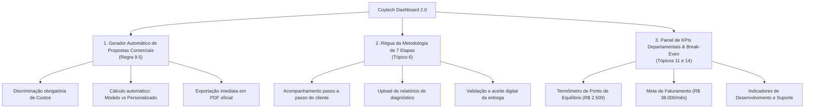

# SDD 09: Relatório de Melhorias do App Coytech Dashboard Baseado no Plano de Negócio

Este documento apresenta uma análise aprofundada de todo o **Plano de Negócio da COYTECH** e estabelece o **Plano Diretor de Evolução do Aplicativo**, mapeando melhorias necessárias, novas funcionalidades e refinamentos de experiência de usuário (UX/UI) em **todas as telas e módulos do sistema**.

---

## 1. Alinhamento Estratégico do Produto com o Negócio

O Plano de Negócio da Coytech estabelece que a empresa não é uma fábrica de software tradicional e nem uma consultoria pontual. Seu valor reside em ser uma **parceira tecnológica completa**, atuando nas três frentes operacionais:

1. **Desenvolvimento de Sistemas Modelos (SaaS Modular):** Softwares padronizados, testados e adaptáveis (Comercial, Financeiro, Operacional, Administrativo e Gestão) com cobrança por assinatura mensal e taxa de setup/implementação.
2. **Desenvolvimento de Sistemas Personalizados:** Soluções sob medida para regras de negócio exclusivas, com remuneração por projeto (R$ 15.000 a R$ 150.000+) e contratos recorrentes de sustentação.
3. **Implementação, Treinamento e Monitoramento Contínuo:** Acompanhamento proativo através de alertas de impacto financeiro (BIA) e suporte mensal (R$ 500 a R$ 3.000/mês), gerando previsibilidade de receita (**MRR**).

Para refletir essa maturidade empresarial, o aplicativo do **Coytech Dashboard** deve evoluir de um painel de monitoramento interno para uma **plataforma operacional completa**, capaz de gerenciar os clientes da Coytech, os produtos comercializados, os fluxos de implantação e a própria saúde financeira da empresa.

---

## 2. Diagnóstico e Melhorias por Tela e Funcionalidade

### 2.1 Dashboard Principal / Home (`/`)
* **Estado Atual:** Exibe visão panorâmica de saúde operacional, atalhos rápidos e métricas consolidadas.
* **Gaps em Relação ao Plano de Negócio:**
  - Não discrimina a receita por modalidade (Sistemas Modelos vs Sistemas Personalizados vs Contratos Recorrentes).
  - Não exibe a contagem de clientes por nicho prioritário (Energia Solar e Imobiliário).
  - Falta uma visão rápida das 7 etapas da metodologia nos projetos em andamento.
* **Melhorias Propostas:**
  1. **Card de Composição de Receita (MRR + Setup):** Exibir gráfico comparativo entre receita recorrente mensal (MRR de assinaturas e suporte) e receita pontual de novos projetos/implementações.
  2. **Widget "Projetos em Implantação":** Listar clientes ativos nas 7 etapas da metodologia operacional (Diagnóstico até Otimização) com barra de progresso visual.
  3. **Radar de Nichos Ativos:** Indicador visual da distribuição de clientes por segmento (Energia Solar, Mercado Imobiliário, Serviços e outros).

---

### 2.2 Painel Executivo Mobile C-Level (`/executivo`)
* **Estado Atual:** Simula a visualização mobile PWA (390×844) voltada para CEOs e diretores, exibindo faturamento, incidentes e aprovações em 1 clique.
* **Gaps em Relação ao Plano de Negócio:**
  - Métricas focadas exclusivamente em e-commerce/varejo, deixando de lado indicadores de prestação de serviços B2B e contratos recorrentes (Tópico 11.4).
  - Não exibe o cumprimento de metas de faturamento e ponto de equilíbrio da empresa.
* **Melhorias Propostas:**
  1. **Seletor de Perfil de Visão:** Permitir alternar entre a "Visão Interna Coytech" (MRR da empresa, clientes ativos, ponto de equilíbrio e pipeline) e a "Visão do Cliente" (faturamento da operação do cliente, chamados e uptime).
  2. **Termômetro de Metas e Break-Even:** Barra de atingimento do ponto de equilíbrio e da meta ilustrativa de R$ 38.000/mês de faturamento bruto (Tópico 11.3).
  3. **Aprovações Rápidas de Propostas:** Permitir que o diretor aprove propostas comerciais e descontos especiais diretamente pelo celular em 1 clique antes do envio ao cliente.

---

### 2.3 Central de Clientes 360º (`/clientes`)
* **Estado Atual:** Tabela com listagem de clientes, prioridade, status de onboarding e modal com múltiplas abas (Tráfego, Demandas, Agenda, CS, etc.).
* **Gaps em Relação ao Plano de Negócio:**
  - Não existe distinção formal entre clientes de "Sistema Modelo" e clientes de "Sistema Personalizado".
  - Não há acompanhamento da esteira da **Metodologia de 7 Etapas** (Tópico 6 do Plano de Negócio).
  - Ausência de um **Funil Comercial / CRM de Vendas** antes do cliente se tornar ativo (Tópico 8.3).
* **Melhorias Propostas:**
  1. **Nova Aba / Seletor "Funil Comercial (Leads)"**: Adicionar visualização em Kanban com as 10 etapas do processo comercial da Coytech:
     * *1. Identificação -> 2. Primeiro Contato -> 3. Reunião de Diagnóstico -> 4. Identificação do Problema -> 5. Apresentação da Solução -> 6. Proposta -> 7. Negociação -> 8. Contratação -> 9. Implementação -> 10. Pós-Venda*.
  2. **Régua da Metodologia de 7 Etapas:** Dentro do perfil do cliente, incluir checklist visual e aprovação de entrega para cada uma das 7 etapas operacionais:
     * *Etapa 1: Diagnóstico (Upload do Relatório)*
     * *Etapa 2: Planejamento (Aprovação da Proposta Técnica/Comercial)*
     * *Etapa 3: Criação & Dev (Homologação técnica)*
     * *Etapa 4: Implementação (Go-live do sistema)*
     * *Etapa 5: Treinamento (Checklist de capacitação das equipes)*
     * *Etapa 6: Monitoramento (Relatório de acompanhamento e NPS)*
     * *Etapa 7: Otimização (Plano de evolução contínua)*
  3. **Especificador de Contrato:** Campo para discriminar módulos contratados do Sistema Modelo (Comercial, Financeiro, Operacional, Administrativo, Gestão) ou escopo do Sistema Personalizado.
  4. **Campos Específicos para Energia Solar e Mercado Imobiliário:**
     * Para Energia Solar: média de propostas fotovoltaicas geradas, integradores parceiros, capacidade instalada monitorada.
     * Para Imobiliárias: número de corretores ativos, volume de leads recebidos de portais (ZAP/VivaReal) e taxa de agendamento de visitas.

---

### 2.4 Gestão de Tarefas, Setores e Projetos (`/tarefas` & `/listas/[listId]`)
* **Estado Atual:** Sistema de pastas por setor, listas por projeto, kanban com drag-and-drop e visualização em lista.
* **Gaps em Relação ao Plano de Negócio:**
  - Não havia estrutura padrão para o Planejamento Estratégico da empresa (agora implementada com as 5 Fases!).
  - Faltam filtros rápidos por departamento responsável oficial da Coytech (Direção, Tecnologia, Implementação, Comercial, Financeiro).
  - Falta controle de horas gastas por tarefa para apuração do custo real por projeto (Tópico 11.4).
* **Melhorias Propostas:**
  1. **Filtro por Departamento Oficial (Tópico 7):** Dropdown para filtrar tarefas instantaneamente por:
     * *Direção e Gestão*
     * *Desenvolvimento e Tecnologia*
     * *Implementação e Projetos*
     * *Comercial e Marketing*
     * *Administrativo e Financeiro*
  2. **Apuração de Horas e Custo (Timesheet Simplificado):** Campo opcional em cada tarefa de "Horas Estimadas" vs "Horas Realizadas", permitindo calcular a rentabilidade real de cada projeto de implementação.
  3. **Visão de Sprints e Cronograma (Gantt/Timeline):** Visualização em linha do tempo baseada nas datas de entrega (`due_date`) para planejamento de entregas mensais.

---

### 2.5 Atendimento WhatsApp & Chat ao Vivo (`/atendimento`)
* **Estado Atual:** Interface de chat em tempo real conectada a conversas de WhatsApp, com botão de transbordo humano (takeover) e histórico.
* **Gaps em Relação ao Plano de Negócio:**
  - As conversas não são convertidas automaticamente em leads no funil comercial da Coytech.
  - Falta suporte a múltiplos atendentes simultâneos por setor (ex: Atendimento Comercial vs Suporte Técnico).
  - Falta registro de motivo de encerramento e nota de satisfação (NPS do atendimento).
* **Melhorias Propostas:**
  1. **Botão "Criar Lead no CRM" em 1 Clique:** Na barra superior do chat, permitir que o operador envie a conversa diretamente para o funil comercial ou crie um cliente 360 preenchido com nome e telefone.
  2. **Roteamento por Fila/Setor:** Possibilidade de transferir o atendimento entre o "Agente Comercial de Vendas (A1)" e o "Agente de Suporte N1 (A3)" ou para operadores humanos específicos.
  3. **Disparo Automático de Pesquisa de Satisfação:** Ao finalizar uma conversa ou ticket de suporte, o bot envia uma mensagem automática com avaliação de 1 a 5 estrelas para alimentar o NPS.

---

### 2.6 Criador & Gestão de Agentes de IA (`/agentes`)
* **Estado Atual:** Lista de agentes ativos (A1 a A5), com detalhes de prompt, ferramentas e execução.
* **Gaps em Relação ao Plano de Negócio:**
  - Não permite clonar ou instanciar um agente específico para um cliente com base de conhecimento (RAG) isolada.
  - Não exibe o custo financeiro em reais por milhão de tokens consumidos de cada agente (Tópico 11.2 - APIs e Infraestrutura).
* **Melhorias Propostas:**
  1. **Catálogo de Agentes Modelos:** Permitir ativar instâncias pré-configuradas para os nichos da Coytech:
     * *Agente Solar Specialist:* treinado para dimensionar placas solares e calcular economia na conta de luz.
     * *Agente Imobiliário Concierge:* treinado para consultar imóveis disponíveis no banco e agendar visitas com corretores.
     * *Agente de Cobrança Humanizada:* treinado para negociar inadimplência e emitir chave Pix com desconto autorizado.
  2. **Dashboard de Consumo de Tokens e Custos:** Gráfico diário de tokens gastos por agente e custo correspondente em R$ (Claude 3.5 Sonnet / OpenAI GPT-4o / Gemini Flash), garantindo que as despesas mensais respeitem o orçamento previsto no Plano de Negócio.

---

### 2.7 Coytech Studio: Filas de Aprovação & Planilhas Migradas (`/studio`)
* **Estado Atual:** Filas de aprovação em 1 clique (pedidos de compra, descontos) e repositório de planilhas migradas.
* **Gaps em Relação ao Plano de Negócio:**
  - Focado apenas em compras; não cobre aprovações de propostas comerciais de serviços, contratos de sistemas personalizados e ordens de serviço.
  - Não contempla o módulo "Administrativo" previsto no Tópico 4.2 (Gestão documental e fluxos de aprovação de contratos).
* **Melhorias Propostas:**
  1. **Expansão das Filas de Aprovação:** Incluir tipos de aprovação para:
     * *Aprovação de Proposta Comercial com Desconto (> 10%)*
     * *Aprovação de Escopo Adicional de Desenvolvimento (Change Request)*
     * *Aprovação de Reembolso de Despesas de Implantação*
  2. **Repositório de Gestão Documental:** Adicionar aba para contratos assinados, termos de aceite de implantação, minutas de NDA e relatórios de diagnóstico das empresas atendidas.

---

### 2.8 Coytech Flow: Automações n8n & Histórico de Execução (`/flow`)
* **Estado Atual:** Lista de automações rodando no n8n, histórico de execuções, minutos manuais economizados e valor financeiro processado.
* **Gaps em Relação ao Plano de Negócio:**
  - Falta catálogo de templates de fluxos prontos para importação rápida nos clientes (acelera a Etapa 4 de Implementação).
  - Não há alerta de retentativa automática em caso de falha de webhooks externos.
* **Melhorias Propostas:**
  1. **Biblioteca de Workflows Pré-Configurados (Sistemas Modelos):**
     * *Fluxo 01: Captura de Lead WhatsApp -> Qualificação IA -> Inserção no CRM.*
     * *Fluxo 02: Fechamento de Venda -> Geração de Cobrança Asaas -> Envio de Pix no WhatsApp.*
     * *Fluxo 03: Alerta de Inadimplência -> Notificação amigável 3 dias antes do vencimento.*
     * *Fluxo 04: Disparo do Relatório Executivo Semanal toda segunda-feira às 08h00.*
  2. **Mecanismo de Retentativa com Circuit Breaker:** Notificação em caso de falhas consecutivas de webhooks para intervenção imediata da equipe técnica.

---

### 2.9 Coytech Pulse: Observabilidade BIA e Incidentes (`/pulse`)
* **Estado Atual:** Monitoramento em 4 camadas com cálculo de impacto financeiro por minuto parado (BIA) e supressão de alarmes falsos.
* **Gaps em Relação ao Plano de Negócio:**
  - Não monitora serviços essenciais para clientes dos nichos prioritários (ex: APIs de portais imobiliários, sistemas de concessionárias de energia ou inversores solares).
  - Alertas não são convertidos automaticamente em tarefas na lista de demandas de suporte.
* **Melhorias Propostas:**
  1. **Monitores Específicos por Vertical:**
     * *Monitor SEFAZ & Emissores Fiscais (NFS-e / NF-e)*
     * *Monitor Gateway de Pagamento (Asaas / Mercado Pago / PIX BACEN)*
     * *Monitor Conexão WhatsApp Z-API (Status da Sessão / QR Code Desconectado)*
  2. **Conversão de Incidente em Tarefa de Suporte:** Botão "Abrir Chamado" que gera automaticamente uma tarefa na lista de manutenção do cliente com prioridade `urgent`.

---

### 2.10 Módulo Financeiro (`/financeiro`)
* **Estado Atual:** Lançamentos de despesas e receitas simples com cálculo de CMV, impostos e lucro líquido básico.
* **Gaps em Relação ao Plano de Negócio:**
  - Não possui módulo de **Contas a Pagar** vs **Contas a Receber** com controle de vencimentos e inadimplência (Tópico 4.2 e 11.4).
  - Não exibe a projeção do **Ponto de Equilíbrio (Break-Even)** conforme detalhado no Tópico 11.5.
  - Não há segregação visual das 8 fontes de receita da Coytech (Tópico 5.4).
* **Melhorias Propostas:**
  1. **Painel de Contas a Pagar e a Receber:** Visão de calendário com lançamentos com vencimento futuro, status (Pendente, Pago, Atrasado) e alerta de cobrança.
  2. **Termômetro de Ponto de Equilíbrio (Break-Even):** Gráfico dinâmico mostrando Custos Fixos (Ferramentas, APIs, Marketing, Contabilidade, Reserva = R$ 2.500/mês + Pró-labore dos sócios) versus Margem de Contribuição gerada pelas receitas.
  3. **Segregação das Fontes de Receita:** Filtro para analisar faturamento por tipo:
     * *Licenciamento/Assinatura de Sistemas Modelos*
     * *Projetos de Desenvolvimento Personalizado*
     * *Serviços de Setup e Implementação*
     * *Manutenção e Suporte Recorrente*
     * *Monitoramento Profissional / Avançado*

---

### 2.11 Marketing & Disparos (`/marketing`) e Tráfego Pago (`/trafego-pago`)
* **Estado Atual:** Gestão de disparos de mensagens e campanhas de anúncios (Meta Ads e Google Ads).
* **Gaps em Relação ao Plano de Negócio:**
  - Não calcula o Custo de Aquisição de Clientes (**CAC**) cruzando investimento em anúncios com novos contratos fechados (Tópico 11.4 e 14).
  - Não possui modelos prontos de copy e criativos para os nichos de Energia Solar e Mercado Imobiliário.
* **Melhorias Propostas:**
  1. **Cálculo Automático de CAC e ROI de Marketing:** Integrar os gastos de mídia com os novos clientes cadastrados no mesmo período para calcular:
     $$\text{CAC} = \frac{\text{Investimento Total em Marketing}}{\text{Novos Clientes Fechados}}$$
  2. **Templates de Criativos e Segmentações para Nichos:**
     * Campanhas prontas para donos de distribuidoras/instaladoras de Energia Solar.
     * Campanhas prontas para diretores e gerentes de imobiliárias locais.

---

### 2.12 Colaboradores e Estrutura Organizacional (`/colaboradores`)
* **Estado Atual:** Gestão de membros da equipe com tipos de acesso (Admin, Membro, Convidado) e notas de RH.
* **Gaps em Relação ao Plano de Negócio:**
  - Cargos e setores não refletem a divisão formal dos **5 Departamentos Oficiais** do Plano de Negócio (Tópico 7).
  - Não há vinculação de metas e KPIs individuais ou departamentais.
* **Melhorias Propostas:**
  1. **Alinhamento dos Cargos com a Estrutura Organizacional (Tópico 7):**
     * *Direção e Gestão* (CEO, Diretor Executivo)
     * *Desenvolvimento e Tecnologia* (Tech Lead, Desenvolvedor Full Stack, Especialista em IA)
     * *Implementação e Projetos* (Gerente de Projetos, Especialista de Onboarding, Suporte N1)
     * *Comercial e Marketing* (SDR, Closer Comercial, Gestor de Tráfego)
     * *Administrativo e Financeiro* (Analista Financeiro, Controller)
  2. **Dashboard de Produtividade do Time:** Exibir volume de tarefas concluídas no prazo, horas trabalhadas e satisfação média nos treinamentos ministrados.

---

### 2.13 Governança, Segurança e LGPD (`/governanca`)
* **Estado Atual:** Validação de credenciais de APIs (Studio, Flow, Pulse) e fluxo de offboarding de clientes.
* **Gaps em Relação ao Plano de Negócio:**
  - Não há checklist formal de conformidade com a LGPD e gestão de termos de confidencialidade (Tópico 12.4).
  - Não há monitoramento de expiração de certificados digitais ou chaves de segurança.
* **Melhorias Propostas:**
  1. **Módulo de Conformidade LGPD por Organização:**
     * Registro de consentimento e termos de tratamento de dados (DPA) assinados.
     * Verificação de status do backup diário do banco de dados (último backup com timestamp).
     * Registro de logs de auditoria para operações sensíveis (exportação de leads ou dados de clientes).
  2. **Cofre Seguro de Credenciais:** Gestão criptografada de tokens de APIs externas e credenciais de acesso de clientes com permissões por cargo.

---

## 3. Inovações Funcionais de Alto Impacto para Implementação

Para consolidar o Coytech Dashboard como a ferramenta definitiva de gestão e comercialização da empresa, recomendamos a criação de **três novos recursos transversais**:

### Inovação 1: Gerador Automático de Propostas Comerciais (Regra 9.5)
O Tópico 9.5 do Plano de Negócio exige que todo orçamento discrimine rigorosamente:
1. Criação do sistema
2. Adaptação / customização
3. Implementação e migração
4. Treinamento das equipes
5. Infraestrutura e licenças
6. Manutenção e suporte mensal

*Solução Proposta:* Criar um formulário interativo no app onde o comercial seleciona o cliente, marca os módulos desejados do Sistema Modelo ou digita as horas do Sistema Personalizado, escolhe o plano de suporte recorrente, e o app gera automaticamente a proposta comercial em PDF com a identidade visual da Coytech e a discriminação financeira oficial.

### Inovação 2: Régua da Metodologia de 7 Etapas Integrada
A metodologia de 7 etapas da Coytech (Diagnóstico, Planejamento, Criação, Implantação, Treinamento, Monitoramento e Otimização) é o principal diferencial competitivo da empresa (Tópicos 1.3 e 6).
*Solução Proposta:* Cada cliente cadastrado terá um "Pipeline de Entrega" com badges dinâmicos. Ao avançar de etapa, o sistema exige a validação da entrega correspondente (ex: na Etapa 1, anexar o Relatório de Diagnóstico; na Etapa 5, registrar a lista de presença do Treinamento).

### Inovação 3: Painel de Indicadores de Desempenho (KPIs do Tópico 14)
Consolidar no Dashboard Executivo os 5 grupos de indicadores obrigatórios da empresa:
* **Comercial:** Leads gerados, reuniões realizadas, propostas enviadas, taxa de conversão e ticket médio.
* **Desenvolvimento:** Projetos entregues no prazo, taxa de retrabalho e chamados de correção abertos.
* **Implementação:** Tempo médio de implantação (dias úteis), taxa de adoção e satisfação dos clientes (NPS).
* **Financeiro:** Faturamento bruto mensal, MRR de contratos recorrentes, margem de contribuição média e inadimplência.
* **Gestão:** Produtividade global da equipe e capacidade operacional instalada.

---

## 4. Conclusão e Próximos Passos Recomendados

Com os **27 projetos e tarefas do Planejamento Estratégico (Tópico 13) já cadastrados e operacionais no banco de dados**, a equipe da Coytech possui clareza absoluta sobre as ações necessárias ao longo das 5 Fases de crescimento.

A implementação gradativa das melhorias descritas neste relatório posicionará o **Coytech Dashboard** não apenas como uma ferramenta interna de ponta, mas como o próprio produto comercial que a empresa demonstrará e entregará aos seus clientes corporativos.
