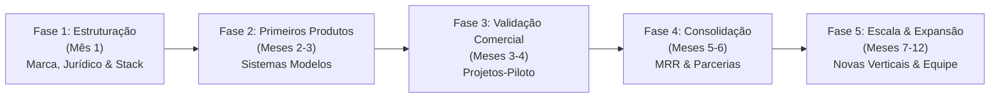

# Documento 04: Planejamento Estratégico e Expansão da Coytech (Fases 1 a 5)

Este documento formaliza as diretrizes estratégicas extraídas do **Tópico 13 (Planejamento Estratégico e Expansão)** e do **Tópico 15 (Cronograma de Implementação)** do Plano de Negócio oficial da **COYTECH**, detalhando os 27 projetos e tarefas cadastrados na base de dados e gerenciados no módulo de Tarefas do Coytech Dashboard (`/tarefas`).

---

## 1. Visão Geral das Fases Estratégicas

O crescimento da Coytech é dividido em **5 fases estruturadas**, cobrindo um ciclo de maturidade de **12 meses**:

---

## 2. Detalhamento dos Projetos e Tarefas por Fase

### Fase 1: Estruturação Empresarial (Mês 1)
**Objetivo:** Preparar a empresa para operar com segurança jurídica, posicionamento de mercado e infraestrutura tecnológica de ponta.

| Código | Tarefa Estratégica | Setor Responsável | Prioridade | Status Inicial | Entrega Chave |
| :--- | :--- | :--- | :--- | :--- | :--- |
| **T-1.1** | Definição de Marca, Posicionamento e Identidade Visual | Comercial e Marketing | Urgente | Em Progresso | Manual de marca, logo dark/light, apresentação comercial e One-Pager institucional. |
| **T-1.2** | Formalização Jurídica e Estrutura Societária (CNPJ e Contratos) | Administrativo e Financeiro | Urgente | A Fazer | Contrato social registrado, CNPJ com CNAEs adequados, enquadramento fiscal e conta PJ. |
| **T-1.3** | Seleção e Setup da Stack Tecnológica & Infraestrutura | Desenvolvimento e Tecnologia | Alta | Concluído | Next.js 16, Supabase PostgreSQL RLS, Vercel CI/CD, n8n, LiteLLM/Claude e Z-API WhatsApp. |
| **T-1.4** | Definição da Metodologia Operacional em 7 Etapas | Implementação e Projetos | Alta | Em Progresso | SOPs e templates das etapas: Diagnóstico, Planejamento, Criação, Implantação, Treinamento, Monitoramento e Otimização. |
| **T-1.5** | Estruturação da Política de Precificação e Modelos de Proposta | Direção e Gestão | Alta | A Fazer | Tabela comercial oficial (Tópico 9) e template de orçamento discriminado (Regra 9.5). |
| **T-1.6** | Política de Proteção de Dados, Segurança e Conformidade com a LGPD | Administrativo e Financeiro | Média | A Fazer | Minutas de DPA/NDA, auditoria de isolamento multi-tenant (RLS) e rotina de backups. |

---

### Fase 2: Desenvolvimento dos Primeiros Produtos (Meses 2 e 3)
**Objetivo:** Construir e homologar os primeiros **Sistemas Modelos** padronizados e modulares da Coytech (Tópico 4.2).

| Código | Tarefa Estratégica | Setor Responsável | Prioridade | Status Inicial | Entrega Chave |
| :--- | :--- | :--- | :--- | :--- | :--- |
| **T-2.1** | Desenvolver Sistema Modelo Comercial (Cadastro 360, Leads & Funil) | Desenvolvimento e Tecnologia | Urgente | Em Progresso | CRM completo com visão 360 do cliente, kanban de funil de vendas e indicadores comerciais. |
| **T-2.2** | Desenvolver Sistema Modelo Financeiro (Contas a Pagar/Receber, DRE e Fluxo) | Desenvolvimento e Tecnologia | Alta | A Fazer | Gestão de caixa, contas a pagar/receber, conciliação e emissão de cobranças Pix/Boleto. |
| **T-2.3** | Desenvolver Sistema Modelo Operacional (Gestão de Tarefas, Kanban & Sprints) | Desenvolvimento e Tecnologia | Urgente | Concluído | Módulo Roomie Office com pastas, listas por setor, kanban com DnD, lista e checklists. |
| **T-2.4** | Construir Painel Modelo de Gestão Central (Dashboard Executivo C-Level) | Desenvolvimento e Tecnologia | Alta | Em Progresso | Tela gerencial consolidando faturamento, MRR, projetos, tickets abertos e metas da empresa. |
| **T-2.5** | Integrar Agente Inteligente de Atendimento WhatsApp (IA 24/7 + n8n) | Desenvolvimento e Tecnologia | Alta | Em Progresso | Triagem automática de leads, qualificação com IA, chat ao vivo e transbordo humano. |
| **T-2.6** | Bateria de Testes Técnicos, Segurança e Homologação dos Modelos | Desenvolvimento e Tecnologia | Média | A Fazer | Testes de estresse, segurança de permissões, compatibilidade mobile e critérios de aceite. |

---

### Fase 3: Validação Comercial & Projetos-Piloto (Meses 3 e 4)
**Objetivo:** Conquistar os primeiros clientes e validar o modelo de negócio no campo de batalha nos nichos de **Energia Solar** e **Mercado Imobiliário** (Tópico 3.2).

| Código | Tarefa Estratégica | Setor Responsável | Prioridade | Status Inicial | Entrega Chave |
| :--- | :--- | :--- | :--- | :--- | :--- |
| **T-3.1** | Prospecção e Fechamento de Projetos-Piloto nos Nichos Foco | Comercial e Marketing | Urgente | A Fazer | 2 a 3 contratos-piloto fechados nos setores de Energia Solar e Imobiliário com condições especiais. |
| **T-3.2** | Implementação Acompanhada dos Pilotos (Etapas 4 e 5) | Implementação e Projetos | Alta | A Fazer | Parametrização dos sistemas, importação de dados, treinamento prático e operação assistida. |
| **T-3.3** | Coleta de Feedback, Medição de KPIs e Correção de Gargalos | Implementação e Projetos | Alta | A Fazer | Pesquisa de satisfação/NPS, cálculo de tempo poupado e publicação de melhorias imediatas. |
| **T-3.4** | Construção de Casos de Sucesso (Case Studies) e Prova Social | Comercial e Marketing | Média | A Fazer | Depoimentos em vídeo/texto, métricas de ROI "Antes vs Depois" e atualização do pitch comercial. |
| **T-3.5** | Calibração da Matriz de Preços, Prazos e Margens Operacionais | Direção e Gestão | Média | A Fazer | Apuração dos custos reais de tokens/servidores e refinamento da tabela de preços final. |

---

### Fase 4: Consolidação e Recorrência (Meses 5 e 6)
**Objetivo:** Tornar a operação previsível, construindo uma base sólida de Receita Recorrente Mensal (MRR) e processos documentados.

| Código | Tarefa Estratégica | Setor Responsável | Prioridade | Status Inicial | Entrega Chave |
| :--- | :--- | :--- | :--- | :--- | :--- |
| **T-4.1** | Estruturação da Máquina de Aquisição Comercial (Inbound + Outbound) | Comercial e Marketing | Alta | A Fazer | Campanhas ativas no Meta Ads/Google Ads, cadência no LinkedIn e meta de 5 demos/semana. |
| **T-4.2** | Expansão de Contratos Recorrentes de Manutenção e Monitoramento (MRR) | Direção e Gestão | Urgente | A Fazer | Conversão de clientes de setup para planos mensais de R$ 500 a R$ 3.000/mês (meta: 10 clientes). |
| **T-4.3** | Padronização de SOPs (Procedimentos Operacionais Padrão) e Manuais | Implementação e Projetos | Média | A Fazer | Manuais passo a passo para setup de contas, instâncias de WhatsApp e suporte N1/N2. |
| **T-4.4** | Formalização de Parcerias Estratégicas e Canal de Indicações | Comercial e Marketing | Média | A Fazer | Acordos com consultorias de gestão, escritórios de contabilidade e agências de marketing. |
| **T-4.5** | Avaliação Financeira, Ponto de Equilíbrio e Metas de Faturamento | Administrativo e Financeiro | Alta | A Fazer | Demonstração do resultado semestral e validação do atingimento do ponto de equilíbrio. |

---

### Fase 5: Escala e Expansão (Meses 7 a 12)
**Objetivo:** Ampliar a capacidade de atendimento, expandir para novas verticais e estruturar uma operação comercial escalável.

| Código | Tarefa Estratégica | Setor Responsável | Prioridade | Status Inicial | Entrega Chave |
| :--- | :--- | :--- | :--- | :--- | :--- |
| **T-5.1** | Plano de Contratação e Estruturação de Equipe Técnica e Comercial | Direção e Gestão | Alta | A Fazer | Contratação de Desenvolvedor Full Stack, Especialista em Automações n8n e SDR comercial. |
| **T-5.2** | Desenvolvimento de Novos Módulos Proprietários Avançados de IA | Desenvolvimento e Tecnologia | Alta | A Fazer | IA preditiva de vendas/churn, agente de cobrança inteligente com Pix e novos conectores ERP. |
| **T-5.3** | Expansão para Novos Mercados e Segmentos Verticais | Comercial e Marketing | Média | A Fazer | Versões especializadas para Saúde/Clínicas, Logística, Varejo e Construção Civil. |
| **T-5.4** | Investimento em Infraestrutura de Alta Confiabilidade e Monitoramento SRE | Desenvolvimento e Tecnologia | Alta | A Fazer | Observabilidade proativa (Pulse SRE), réplicas de banco de dados e garantia de 99,9% SLA. |
| **T-5.5** | Estruturação de Operação Comercial Escalável e Programa de Canais | Direção e Gestão | Média | A Fazer | Playbook de vendas consolidado e programa de parceiros certificados para revenda/implantação. |

---

## 3. Matriz de Atribuição Departamental (Tópico 7)

Todas as tarefas são atribuídas diretamente aos **5 departamentos oficiais da Coytech**:
1. **Direção e Gestão:** Estratégia global, precificação oficial, parcerias executivas, contratações e governança.
2. **Desenvolvimento e Tecnologia:** Engenharia de software (Next.js/Supabase), automações (n8n), agentes de inteligência artificial e segurança técnica.
3. **Implementação e Projetos:** Onboarding técnico, gestão dos prazos de entrega, treinamento dos usuários clientes e suporte assistido.
4. **Comercial e Marketing:** Geração de leads, reuniões de diagnóstico, apresentações de propostas comerciais e produção de cases de sucesso.
5. **Administrativo e Financeiro:** Formalização societária, contratos, conformidade jurídica/LGPD, cobranças automáticas, conciliação e relatórios de fluxo de caixa.

---

## 4. Cronograma de 12 Meses Integrado ao App

| Mês | Foco Operacional | Marco Estratégico |
| :--- | :--- | :--- |
| **Mês 1** | Estruturação empresarial, identidade e stack técnica. | CNPJ ativo, infraestrutura provisionada e metodologia documentada. |
| **Mês 2** | Desenvolvimento e parametrização dos Sistemas Modelos. | Módulos Comercial, Financeiro, Operacional e IA prontos para uso. |
| **Mês 3** | Testes técnicos, homologação e prospecção de pilotos. | Sistemas modelos testados e primeiros contatos com Energia Solar e Imobiliárias. |
| **Mês 4** | Início da operação assistida nos projetos-piloto. | 2 a 3 pilotos rodando em produção com acompanhamento diário. |
| **Mês 5** | Coleta de feedback, ajustes finos e criação de cases. | Primeiro Case Study publicado e tabela de preços calibrada. |
| **Mês 6** | Consolidação comercial, MRR e avaliação do ponto de equilíbrio. | Atingimento do break-even e meta de faturamento ilustrativo de R$ 38.000/mês. |
| **Meses 7–9** | Ampliação do portfólio e contratação de novos talentos. | Novos módulos de IA proprietária e contratação do primeiro dev/automações. |
| **Meses 10–12** | Expansão para verticais (Saúde, Varejo, Logística) e canais de escala. | Programa de parceiros integradores ativo e operação comercial escalável. |
